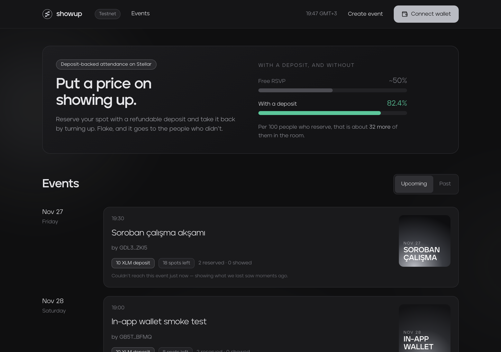
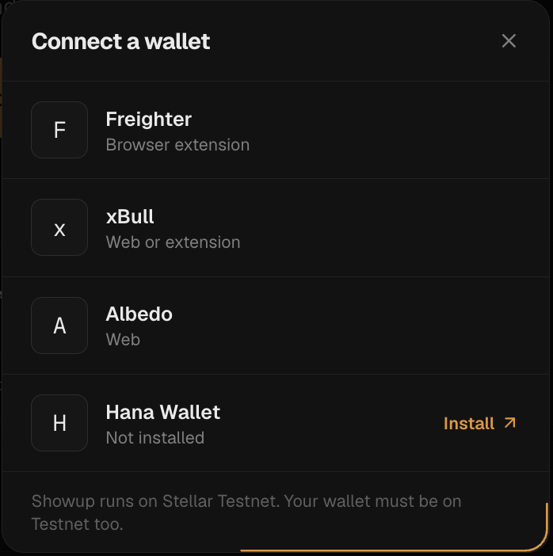
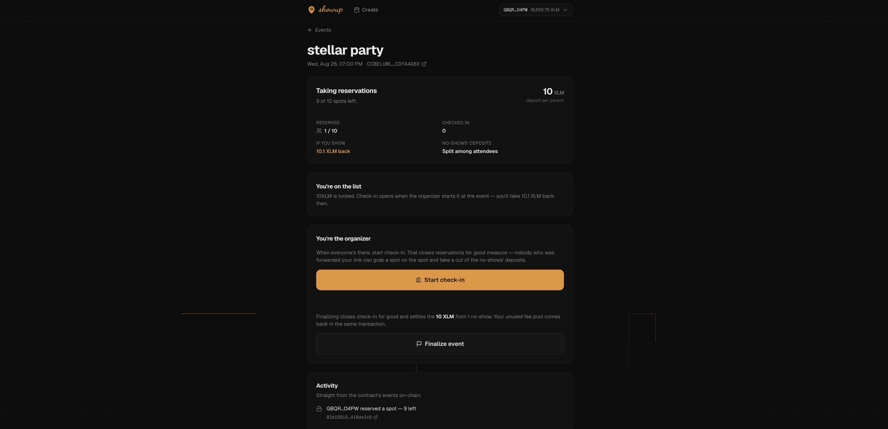
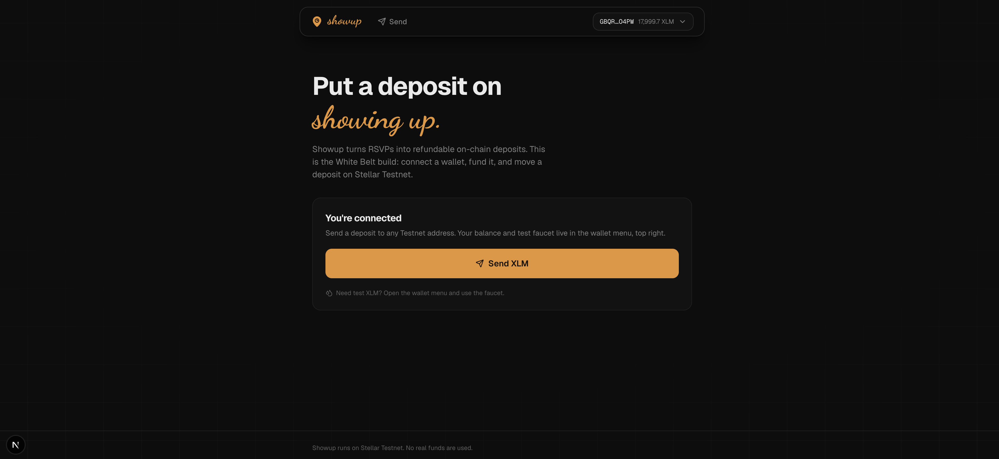
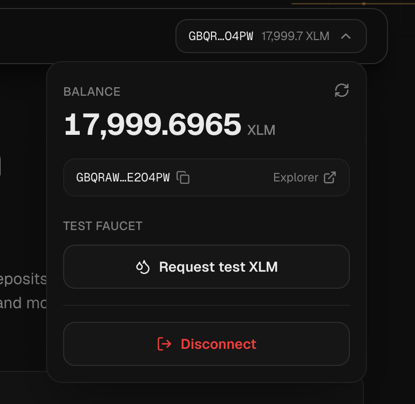
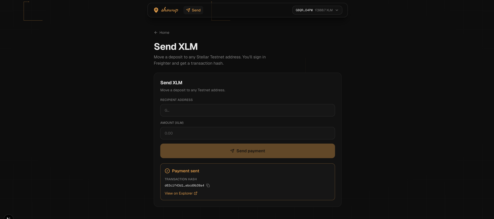
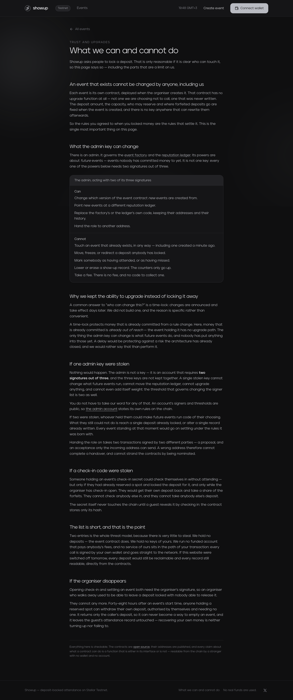
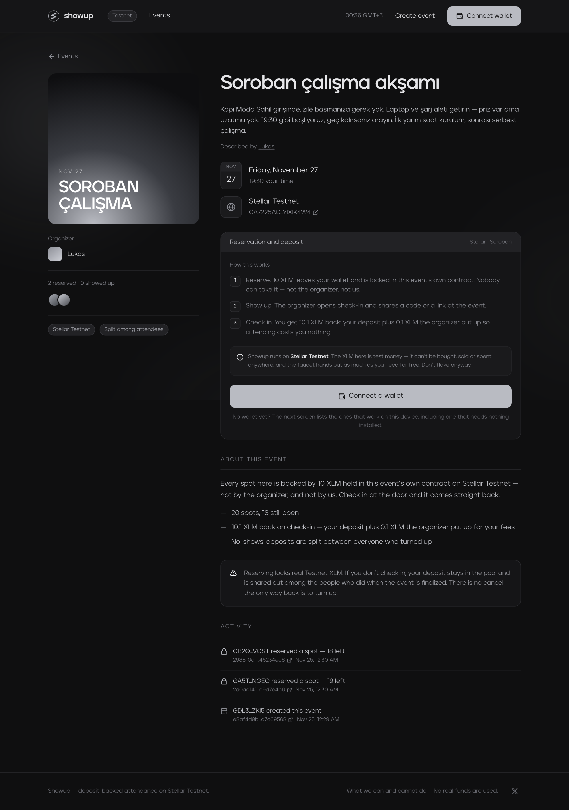

# Showup

**Put a refundable deposit on showing up.** Showup turns event RSVPs into
on-chain deposits on [Stellar](https://stellar.org): reserve your spot with a
small deposit, check in at the event, and reclaim it. No-shows forfeit — so the
people who actually show up are the ones who get rewarded.

It's the anti-flake primitive for meetups, study groups, game nights, and calls —
a "skin in the game" layer that a group chat can never enforce.

> **Network:** every contract this README publishes an address for is on Stellar
> **Testnet**, and no real funds have moved through any of them. Mainnet is in
> scope for the engagement running now and is not deployed yet — see
> [*Two networks, one build*](#two-networks-one-build).

[](https://github.com/lukascakici/showup/actions/workflows/ci.yml)

- **Live demo:** **[testnet.showup.click](https://testnet.showup.click)** — and
  **[showup.click](https://showup.click)**, which serves Testnet until the Mainnet
  contracts exist
- **What it does, in 15 seconds:** **[the overview](https://youtu.be/0s9vVx6JVSg)**
- **Demo video:** **[the full flow, start to finish](https://youtu.be/QaT61imDXkk)**

<p align="center">
  
</p>

<p align="center">
  <sub>The live site on 25.11.2026. The one it replaced, from 15.07.2026, is still in
  <code>docs/screenshots/home.png</code> — amber, a floating glass bar, and "connect your
  Freighter wallet", none of which are true any more.</sub>
</p>

This README is organised by the deliverables it is built against, in order. It is
cumulative: it grows as things ship, and nothing that shipped ever disappears from
it.

| Deliverable | What it is | State |
| :-- | :-- | :-- |
| **[1](#deliverable-1--a-deployed-multi-wallet-dapp-with-ci)** | A deployed multi-wallet dApp, with CI on every push | shipped |
| **[2](#deliverable-2--the-on-chain-reputation-contract)** | An on-chain `reputation` contract, written by the events themselves | shipped |
| **[3](#deliverable-3--one-real-event-10-real-attendees-a-demo-video)** | One real event, 10+ real attendees, a demo video | shipped |

**Two further engagements followed, and they grew these same three sections rather
than starting new ones** — one record, not three:

| Second engagement | What it is | Where it lives here |
| :-- | :-- | :-- |
| 1 | Admission, enforced on-chain | [Deliverable 1](#deliverable-1--a-deployed-multi-wallet-dapp-with-ci) — four gates, co-hosting |
| 2 | A reputation record worth reading | [Deliverable 2](#deliverable-2--the-on-chain-reputation-contract) — vouching, the full record, `/u/<address>` |
| 3 | The product those mechanics need | [Deliverable 1](#deliverable-1--a-deployed-multi-wallet-dapp-with-ci) — names, the conversation, onboarding — and [Deliverable 3](#deliverable-3--one-real-event-10-real-attendees-a-demo-video) for the run it was proved on |

| Third engagement | What it is | Where it lives here |
| :-- | :-- | :-- |
| 1 | A deposit nobody can strand | [Deliverable 1](#deliverable-1--a-deployed-multi-wallet-dapp-with-ci) — `reclaim`, the corrected settlement, bounded amounts |
| 2 | Audit readiness | [Deliverable 2](#deliverable-2--the-on-chain-reputation-contract) — a blocking security gate, and an admin no single key can move |
| 3 | Real money, and the product around it | [Deliverable 3](#deliverable-3--one-real-event-10-real-attendees-a-demo-video) — two networks from two hostnames, events in their host's own words |

The third is **in progress** — it runs to 10.12.2026, and the Mainnet deployment
it builds toward has not happened yet. Everything described below exists and is
verifiable today; where something is still ahead, this README says so rather than
writing it in the past tense.

Reviewing rather than reading? **[docs/SOW1](docs/SOW1/)** and
**[docs/SOW2](docs/SOW2/)** have one short page per deliverable, written against
each SOW's §6.1 and readable without a technical background; **[docs/SOW3](docs/SOW3/)**
holds the third engagement's security report. The sections below are the same record
with the engineering in it.

The second engagement's contracts were upgraded **in place**, so nothing in the
first engagement's evidence has been invalidated: every address on those pages is
still the address, and the fourteen scores earned then were compared before and
after the upgrade and are unchanged.

---

## Deliverable 1 — a deployed multi-wallet dApp, with CI

The app people actually touch: connect any of five Stellar wallets, get funded,
create an event, reserve a spot, check in, and reclaim — with a transaction hash
for every step.

### Features

**Wallets, balances and payments**

- **Five wallets** — Freighter, xBull, Albedo and Hana via
  [StellarWalletsKit](https://github.com/Creit-Tech/Stellar-Wallets-Kit), plus
  **WalletConnect**, behind a flat picker of our own rather than the kit's modal,
  with silent reconnect.
- **Balance** fetched from Horizon and shown in a wallet menu, with copy-address
  and Stellar Explorer links.
- **Built-in faucet** — fund a new account with 10,000 test XLM via Friendbot,
  with honest "already funded" messaging.
- **Send XLM** to any address with client-side validation, wallet signing, and a
  **transaction hash + Explorer link** on success. *Shipped in week 1 and
  **removed on 07.08.2026** — it was a standalone payment tool from before the
  contracts existed, and once every deposit moves through an event contract there
  was nothing left for it to do. The screenshot below stays as the record of it.*
- **Robust error handling** — wallet not installed, request rejected, pop-up
  blocked, wrong network, underfunded, non-existent destination, stale-sequence
  retries and every contract error code, all mapped to plain-language copy. Each
  wallet reports failure differently and none of them throw an `Error`, so the
  mapping is written against the shipped source of all five.
- **Silver-on-off-black UI** — flat surfaces stacked by depth, a single neutral
  silver accent taken off the logo mark, and one green kept for a deposit coming
  back. Jeko throughout, self-hosted and Turkish-complete, so headings, body,
  balances and addresses are all one face. Per-event posters derive their colourway
  from the event's own address, so the same event wears the same poster in every
  browser with nothing stored to keep it that way.

**Events, end to end**

- **Create an event** — name, start time, deposit, capacity and a forfeit policy.
  The factory deploys a fresh contract and funds its fee pool in one transaction.
- **The moment after creating** hands over both links rather than redirecting: the
  **invite link** (safe to post anywhere) and the **check-in link** (which is the
  organizer's only backup of a code nobody, including us, can recover), each with
  a QR code.
- **Reserve, check in, finalize** — every action is a signed contract call with its
  hash on screen and a link to Stellar Expert.
- **An activity feed** read back from the contract's own on-chain events, showing
  the transaction hash of each one rather than its ledger number.
- **The event list** is sorted by when events start and grouped by day — Today,
  Tomorrow, then dates, then Earlier — rather than by the order the factory
  happened to register them.

**Getting a stranger from a link to a reservation**

Everything in this group exists because Deliverable 3 depends on ten people who
have never used Stellar finishing this on their own phone, unattended.

- **A cold visitor gets an explanation before a signature request** — what a
  deposit is, in three steps, with this event's own numbers, and the fact that
  Testnet XLM is not real money and the faucet is free.
- **The funding pre-flight** asks whether an account can afford the deposit
  *before* the wallet prompt, and offers the faucet in the same card when it
  can't. It withholds the 1 XLM base reserve Stellar locks in every account and
  never lets it be counted as spendable — the reason a balance of exactly 10
  cannot pay a 10 XLM deposit.
- **A wrong-network banner** naming the wallet, the network it is on, and the fix.
  It is a warning rather than a lock, and it can be told to check again.
- **No dead ends in the wallet picker** — install links for what is missing, a
  "check again" for after you install something, and advice that changes with the
  device, since "install the extension" is useless on a phone.

**Admission — four gates the contract enforces**

Who may take a spot is chosen when the event is created and checked inside `rsvp`,
**not by the screen**. A gate a frontend applies is a suggestion: anyone can call the
contract directly, so every one of these refuses on-chain with its own error.

- **`Open`** — anyone, first come first served.
- **`Score(n)`** — anyone whose reputation record shows at least `n` check-ins.
  Refused with `ScoreTooLow`, and the score it reads was written by a *different*
  event contract.
- **`Approval`** — anyone the organizer says yes to, one at a time. An application
  costs nothing and moves no money; the deposit is taken at `rsvp`, **after** the
  yes, so nothing is held while somebody waits for an answer. A declined applicant
  cannot re-apply their way back into an inbox.
- **`Vouch(n)`** — anyone `n` members with records of their own will back. This is
  the answer to the cold-start problem that is not an allowlist: a vouch is a signed
  public statement that **costs the voucher** if the person they backed does not turn
  up.
- **Co-hosts.** `add_host` / `remove_host` let more than one wallet run an event —
  open check-in, admit an applicant, finalize — while forfeited deposits still only
  ever pay the original organizer. Who may *act* and who gets *paid* are deliberately
  two different lists.
- **The gate explains itself before it asks for a wallet.** An event page says what
  it wants of you — *needs a vouch*, *regulars only*, *by approval* — while you are
  still a stranger to it, rather than after a connect prompt.

**The product around the gates**

- **A wallet can have a name.** Claimed by signing a challenge transaction, so a name
  can only be set by whoever holds the key. It renders wherever an address would.
- **Every event has a conversation**, scoped to the people holding a spot in it and
  its hosts. Membership is read off the **contract** on every request — `get_reserved`,
  `get_checked_in`, the host list — rather than from a Firestore rule, because a rule
  can only see the mirrored guest list and no rule can read a contract.
- **A public record page** at `/u/<address>`, readable by anyone, assembled from the
  ledger: shows, no-shows, turnout, vouches given and broken.
- **Records are mirrored off-chain after being read from the chain**, so a page that
  shows history does not re-read the whole ledger on every view. Nothing in the
  request body can reach a stored number: the sync route accepts an address and
  reads every figure from the contract itself.

**A deposit nobody can strand**

The first two engagements had one gap nobody had been bitten by yet, which is the
only kind worth closing before real money arrives: **every way a deposit came back
required the organizer to do something.** Check-in needed them to open it, the
settlement needed them to call `finalize`. An organizer who simply stopped — lost
the key, lost interest, got hit by a bus — left everybody's money locked in a
contract with no path out, forever.

- **`reclaim(guest)`** — 48 hours after the start time, any guest holding a
  reservation takes their own deposit back, signed by themselves, **with no
  organizer involved and no admin anywhere in the path.** Not a refund somebody
  grants; a door in the contract that opens on a clock. The 48 hours are the
  organizer's to settle in: before that it refuses with `ReclaimTooEarly`, because
  a reclaim and a `finalize` racing each other is the one case where both are
  legitimate.
- **The settlement was corrected to match.** `finalize` now subtracts reclaimers
  before working out the no-shows. Without that term the contract tries to
  redistribute money that has already left, the transfer traps, and an event that
  was abandoned *and* partly reclaimed could never be settled at all — stranding
  precisely the people who waited rather than walking out.
- **The organizer's abandonment is recorded, on its own counter.** The *first*
  reclaim writes `record_abandoned` against whoever created the event: there is no
  `finalize` to carry that write, which is the whole point, so the first guest
  giving up on the organizer is what carries it. It is `events_abandoned`, kept
  separate from `events_organised`, and the guest's own record is untouched — a
  reclaim is neither attendance nor absence.
- **The guest never pays for the ledger being down.** The write goes through
  `try_record_abandoned`: a reputation contract that is unreachable must never take
  somebody's deposit with it.

**Amounts that cannot overflow, and a settlement that refuses rather than guesses**

- **The ceiling is fixed at creation.** `deposit + fee_allowance`, multiplied across
  the whole capacity, has to fit in an `i128` or the event is never deployed —
  refused with `AmountsTooLarge`. These three numbers are the organizer's to choose,
  and creation is the only moment they can be rejected while nobody's money depends
  on them yet.
- **Every line of the money path is `checked_`**, and a failure returns
  `InvariantViolated` rather than trapping. It is unreachable by construction — the
  ceiling bounds the amounts, the capacity guard bounds the lists — but "provably in
  range" rests on invariants enforced in *other* functions, and that is exactly the
  reasoning that rots when somebody changes one of them. **A refusal can be
  diagnosed and recovered from; a wrong payout cannot.**
- **Deliberately not saturating arithmetic**, which is the obvious reading of an
  overflow finding and would have been the wrong fix here: a saturating subtraction
  turns a broken invariant into a plausible-looking wrong number, and in `finalize`
  that number is how much money each attendee receives.
- **Eight error codes stopped falling through to "please try again."** Codes 24–31 —
  the four from vouching and the four from the reclaim and the bounds — were landing
  on the generic retry message. Not one of them is helped by retrying, which is the
  single piece of advice that whole list of messages exists to stop giving.

**Honest states everywhere**

- **Loading, empty and broken are three different things**, and are no longer
  rendered as one. A feed that is still loading does not claim the event has no
  history; a failed read does not claim the event does not exist; numbers that
  have stopped updating say so instead of sitting there looking live.
- **`restoring`** — the app knows the difference between "nobody is connected" and
  "we haven't finished asking", so a returning visitor stops seeing a connect
  button flash before their wallet appears.

**Built for a phone**

The home page, the create page, a live event page and the wallet picker were each
measured at 280, 320, 375 and 390 px wide and in landscape: 16px inputs so iOS
never force-zooms a form, 44px tap targets, a picker that scrolls instead of
putting its own button off-screen, and no horizontal scroll anywhere.

Three of those are now checked on **every push** rather than the once somebody
remembers. [`scripts/mobile-audit.mjs`](scripts/mobile-audit.mjs) reads the source
and fails the build on an input under 16px, a tap target under 44px, or a fixed
width wide enough to hang off a 320px screen — each rule earned by a fault that
had already shipped. It also prints, every run, the three things it **cannot** see:
overlapping text, a heading that wraps badly at 280px, and a sheet that opens off
the bottom of the screen. A checker that implies it has looked at the phone for you
is worse than no checker.

**Continuous integration**

Every push runs three jobs. **Contracts:** pinned Rust toolchain, `cargo fmt
--check`, build the wasm *before* clippy and tests (the event tests
`contractimport!` it), a check that the committed TypeScript bindings still match
the contract source, a check that **the wasm hash published in this README is
what the deployed factory actually deploys** — asked of the live chain, not of a
local build — then clippy with `-D warnings`, then 166 contract tests. **Web:**
lint with `--max-warnings=0`, typecheck, 355 tests, build. **Security:** static
analysis of the contracts, failing the build on anything the triaged baseline
does not already account for — see
[*A security pass with a gate behind it*](#a-security-pass-with-a-gate-behind-it).

### Architecture

```
showup/
├── contracts/
│   ├── interfaces/        # #[contractclient] traits + shared constants (lib only)
│   ├── event/             # one deployed contract per event: deposits, phases, refunds
│   ├── factory/           # deploys events, funds fee pools, registers them for scoring
│   └── reputation/        # the show-up ledger (Deliverable 2)
├── web/
│   ├── src/
│   │   ├── app/           # Next.js App Router: pages (/, /create, /e/[id],
│   │   │                  #   /u/[address], /trust, the check-in link) and the
│   │   │                  #   API routes the pages and the cron call
│   │   ├── components/    # UI; the states worth pinning have component tests
│   │   ├── lib/           # chain reads, wallet kit, contract clients, the
│   │   │                  #   network registry, pure helpers
│   │   └── test/          # test-only helpers (a render that supplies a network,
│   │                      #   a controllable matchMedia)
│   └── scripts/           # evidence collection, the admin multisig tools
├── scripts/               # CI checks and the measuring tools (mobile audit,
│                          #   wasm hash, bindings, the Scout gate)
├── docs/
│   ├── deployments.md     # every address, every hash, what each one cost
│   ├── SOW1/ SOW2/ SOW3/  # one short page per deliverable, per engagement
│   └── screenshots/
└── .github/workflows/ci.yml
```

| Setting | Value | Why |
| :-- | :-- | :-- |
| Node | **24** | pinned in `web/package.json`, matched by CI and Vercel |
| Rust target | **`wasm32v1-none`** | what Soroban runs |
| Workspace profile | **`lto = false`** | `lto = true` miscompiles some `soroban-sdk` builds |
| Vercel Root Directory | **`web`** | the repo is a monorepo; the Next app is one subtree |
| Package manager | **npm** | the lockfile CI installs from |
| Inter-contract calls | via the **`interfaces`** crate | depending on another *contract* crate pollutes the wasm spec |

**Nothing in the configuration is load-bearing for the chain.** Every address the
app needs is compiled in, so a checkout with an empty `.env` still connects a
wallet, reserves a spot and reclaims a deposit. What the variables below buy is
the off-chain half — the parts that remember things the ledger does not — and each
one is written to be *absent*, not assumed:

| Variable | What it is for | Without it |
| :-- | :-- | :-- |
| `NEXT_PUBLIC_WALLETCONNECT_PROJECT_ID` | identifies the app to the WalletConnect relay | the WalletConnect row isn't offered; the other four wallets work |
| `NEXT_PUBLIC_FIREBASE_*` (six) | the client SDK's project config — the read side of the index | the app reads events, activity and records straight from the chain, exactly as it did before the index existed |
| `FIREBASE_SERVICE_ACCOUNT` | server-side Firestore, for names, mirrored records and event descriptions | each reads as *not written yet* rather than failing |
| `SESSION_SECRET` | signs the token that proves a guest holds a spot | `/api/session` answers 503 and says so |
| `CRON_SECRET` | authenticates Vercel Cron to the sweep | the sweep **refuses to run** rather than running unauthenticated |
| `NEXT_PUBLIC_MAINNET_RPC_URL` | the Mainnet RPC endpoint | Mainnet is not a live network and every hostname serves Testnet |
| `NEXT_PUBLIC_SITE_URL` | overrides the host invite links are built from | links use `testnet.showup.click`, or `showup.click` on Mainnet |

The `NEXT_PUBLIC_` ones are public by design: they ship in the client bundle, and
all of them identify rather than authorise. The other three are server-only and
read in code that can never run in a browser. The pattern they share is the
interesting part — `CRON_SECRET` was unset once and the sweep ran anyway, because
the guard was written as "reject if the secret is set and does not match". Both
secrets now refuse on absence, and `SESSION_SECRET` was written that way from the
start *because* of that bug.

### Evidence

SOW §6.1 asks Deliverable 1 for a live link, a repo with CI passing, and two
screenshots — the wallet-selection dialog, and a completed transaction with its
hash and Explorer link.

| What | Where |
| :-- | :-- |
| Live link | **[showup.click](https://showup.click)** — and **[testnet.showup.click](https://testnet.showup.click)**, which is where Testnet lives now that there are two hostnames |
| CI passing | [the badge above](https://github.com/lukascakici/showup/actions/workflows/ci.yml), green on every push |
| Wallet-selection dialog | below |
| A completed transaction, with its hash and Explorer link | below |

| The wallet picker | An event created, with its transaction hash |
| :--: | :--: |
|  |  |

The picker was captured in week 1, so it shows the four wallets offered then;
WalletConnect was added in week 3 and appears as a fifth row on the live site.

The transactions behind the second screenshot were made **through the app's own
UI and signed in a browser wallet**, not from the CLI — which is the part a
screenshot alone cannot prove:

[`CCBELUML…CDYA4G6X`](https://stellar.expert/explorer/testnet/contract/CCBELUML3QPYDXC7RSQUD3GPDCZ6P3DZYORTY6MCBRMIHFKLCDYA4G6X) — *"stellar party"*, 10 XLM deposit, capacity 10

| Action | Transaction |
| :-- | :-- |
| `create_event` | [`ca6c547481a3704198f027157acba1bfd4f3b45f14210039daa06c97f5104ffe`](https://stellar.expert/explorer/testnet/tx/ca6c547481a3704198f027157acba1bfd4f3b45f14210039daa06c97f5104ffe) |
| `rsvp` — the row visible in the screenshot | [`03d159194db4242e884c2b85d00fb4ea7c729e0b4684ec5e7e8ee35a416de3c8`](https://stellar.expert/explorer/testnet/tx/03d159194db4242e884c2b85d00fb4ea7c729e0b4684ec5e7e8ee35a416de3c8) |

| Wallet connected | Balance + faucet |
| :--: | :--: |
|  |  |

Both from week 1 as well, and kept as that week's record rather than refreshed.
The current equivalents are in
[`docs/screenshots/sow3/`](docs/screenshots/sow3), captured from the live site on
25.11.2026.

| Successful transaction — from the send tool, since removed |
| :--: |
|  |

Taking the `event-created.png` screenshot took two attempts and changed the
product, which is worth recording rather than tidying away. The first attempt
showed `ledger 4056613` where a hash should have been — activity rows linked to
Stellar Expert but printed the ledger number, so the evidence was in the href and
nowhere a reader could see it. The same screenshot showed the heading `Event` on
an event that by then had a name on-chain, because the detail page had never been
taught to read `title`. Both are fixed. The screenshot requirement found two real
gaps that the tests did not.

#### A deposit recovered from an organizer who never came back

The third engagement's addition to this deliverable, proved on the live chain
rather than only in tests. An event was created with a start time two days in the
past, reserved by a guest, and then **abandoned** — the organizer never called
anything again.

| | |
| :-- | :-- |
| Event | [`CAYQHGRP…V4L7KCAK5`](https://stellar.expert/explorer/testnet/contract/CAYQHGRPZ7SKAESRPNJRK6RQZBDYZWYZFHGYO2LW3U5MNETV4L7KCAK5) |
| Organizer, who abandoned it | `GD2CEL7T…MXMPVMRY5H` |
| Guest, who got their own money out | `GASUZI3H…R6FZWTODEDY` |
| `rsvp` — 1 XLM locked | [`369dc200…9113f75d`](https://stellar.expert/explorer/testnet/tx/369dc200cc5555b9c7d08f74347382f7765ab1de942182af480022c29113f75d) |
| **`reclaim` — 1 XLM back, no organizer in the transaction at all** | [**`dc0ec0e2…4232d0b3be`**](https://stellar.expert/explorer/testnet/tx/dc0ec0e27c1b6bb91d4f24475028c1e653597c4169853e7956c9594232d0b3be) |

Read back afterwards with no key, no funded account and no signature: the
organizer's `events_abandoned` went from 0 to **1**, the guest's own record stayed
at all zeros — a reclaim is neither attendance nor absence — and a second
`reclaim` from the same wallet is refused `Error(Contract, #29)`,
`AlreadyReclaimed`. The commands to re-derive each of those are in
[docs/deployments.md](docs/deployments.md#proven-on-the-live-chain-not-only-in-tests).

The amount ceiling is demonstrable the same way, against the live factory:
`create_event` with a deposit of `i128::MAX` is refused `Error(Contract, #30)`,
`AmountsTooLarge`, and nothing is deployed. **Neither refusal has a transaction
hash and neither can** — Soroban simulates before it submits, so a refused call
never becomes a transaction. The error code and a command anybody can run are the
honest evidence, and both are in
[docs/deployments.md](docs/deployments.md#proven-on-the-live-chain).

---

## Deliverable 2 — the on-chain `reputation` contract

A show-up score that only the chain can write. It rises when someone checks in
and falls when a finalised event finds them missing — in the **same transaction**
as the money it describes, so the score and the settlement can never disagree.

### Features

- **`record_checkin` / `record_no_show`** — called by an event contract, never by
  a person and never by the frontend. The app has no code path that writes a
  score at all.
- **Factory-gated.** `register_event` accepts a registration only when the caller
  is the factory this ledger was pointed at, so a score can only ever be the
  consequence of an event the factory itself deployed. Anything else is refused
  on-chain with `NotAnEvent`.
- **`get_score(member)`** returns `{ shows, no_shows }` — read by anyone, written
  by nobody outside that gate.
- **`get_record(member)`** returns the whole record: `shows`, `no_shows`,
  `vouches_given`, `vouches_broken`, `events_organised`. It is assembled at read
  time and never stored, because **`Score` is frozen.** A `#[contracttype]` used as
  a *stored* type cannot grow a field: every entry already in the ledger was
  written by an older wasm, and a client generated from a wider struct cannot
  decode them. So the new counters live in a separately keyed `Extras` entry that a
  member is allowed not to have, and the reader defaults instead of unwrapping.
- **Vouching** — `vouch(voucher, guest)` on an event lets a member put their own
  record behind somebody who has none, which is the only answer to a score gate's
  cold-start problem that does not amount to an allowlist. It refuses a voucher who
  does not qualify (`CannotVouch`), a second vouch for the same guest
  (`AlreadyVouched`, or "two members vouched" would mean "one member clicked
  twice"), and vouching for yourself (`CannotVouchForYourself`). It moves no money
  and takes no spot: it is permission to reserve, not a reservation.
- **A broken vouch costs the voucher, on its own counter.** If a vouched-in guest
  never turns up, `finalize` records it against whoever backed them — in the same
  invocation as the settlement. It is **not** deducted from `shows`: the voucher did
  turn up to everything they turned up to, and rewriting that would make the
  attendance count mean two things at once. Qualifying to vouch requires
  `vouches_broken == 0`, so one bad call closes the door permanently and **no amount
  of attendance clears it** — which is what stops somebody buying the right to keep
  waving strangers in.
- **`record_organised`** — the organizer's own line, written at settlement rather
  than at creation, because an event that was deployed and abandoned is not an
  event anybody ran.
- **Every decision reads the contract; every *display* reads a mirror of it.** A
  record is backward-looking, and `get_record` is one RPC round trip per wallet on
  pages that poll and want a dozen at once. So `/api/records/sync` reads records off
  the chain and writes them to Firestore, and the pages that *show* a record read
  from there with the time it was read printed underneath. Nothing that decides
  anything goes through the mirror: admission, vouching and settlement all read the
  contract at the moment they act. The mirror cannot become an editable second
  version of a record either — the route accepts addresses and nothing else, there
  is no code path from a request body to a stored number, and `firestore.rules`
  denies client writes outright.
- **`renew(member)` takes no auth and no admin.** Soroban rents state, and every
  write already extends what it wrote — which quietly meant a record survived only
  while its owner kept attending things, expiring precisely for the person who had
  stopped needing to prove anything. Anyone who cares about a record can now pay to
  keep it alive. Renewing a record that was never written is a no-op rather than an
  error, so nobody can fill the ledger with blank entries at our expense.
- **Written atomically with the settlement.** `check_in` refunds the deposit *and*
  raises the score in one invocation; `finalize` moves the forfeited deposits,
  returns the unspent fee pool *and* lowers the flakes' scores in one more. There
  is no window in which the money has moved and the record has not.
- **Inter-contract calls go through the `interfaces` crate** — `#[contractclient]`
  traits, never a dependency on another contract crate, which would drag that
  contract's whole spec into this one's wasm.
- **Admin-gated `set_factory` and `upgrade`** on the ledger, and
  `set_event_wasm_hash`, `set_reputation` and `upgrade` on the factory. The v1
  factory had none of these and had to be replaced to add scoring at all; that
  mistake is now unrepeatable.
- **State rent is paid deliberately.** Instance and persistent entries extend
  their own leases on write, to 90 days, past a 30-day threshold — after a week 2
  incident in which contract state simply expired.
- **The event contract deliberately has no `upgrade`.** A deployed event holds
  other people's deposits under rules they agreed to; being able to rewrite those
  rules afterwards is not a feature.

### A security pass with a gate behind it

Before these contracts go anywhere near real money they were frozen at one commit
and put through the static analysis an audit expects to have been run first. The
result is **[docs/SOW3/security.md](docs/SOW3/security.md)**: every finding, what
was done about it, and the reasoning for everything deliberately left alone.

- **73 findings. Twelve fixed, including every critical one**; the remaining 61
  each carry a written decision. A report with no findings is a report nobody
  believes — eleven `integer_overflow_or_underflow` criticals were real, and the
  arithmetic they pointed at is now bounded.
- **[CoinFabrik Scout](https://github.com/CoinFabrik/scout-audit) `0.3.17`, pinned**,
  39 detectors, run over all four crates. Pinned because a detector set that moves
  underneath a report makes every finding in it unreproducible.
- **It runs on every push that touches the contracts, and it blocks.** It spent its
  first weeks as `continue-on-error` while the findings were untriaged, because a
  job that is red on 73 known findings is a job everybody learns to ignore.
- **The gate is a baseline, not a count of zero.**
  [`scripts/check-scout-baseline.mjs`](scripts/check-scout-baseline.mjs) fails the
  build on any critical, on any detector that rises above the number recorded
  against it — and, deliberately, **on an empty report**. Zero findings does not
  mean the code got clean; it usually means the analysis never ran, and that is the
  failure a gate has to be able to tell from success.
- **The scope rule is the whole push, not the last commit.** A push of two commits
  where only the earlier one touches the contracts is exactly the case the narrower
  form gets wrong — and it got it wrong here, letting the fix to this very job reach
  `main` unanalysed, alongside a web-only commit.

**Both contracts are now governed by a 2-of-3 account.** `propose_admin` /
`accept_admin` moved the admin of the factory and the reputation ledger to
[`GBWMYPV6…LEAF5QQF`](https://stellar.expert/explorer/testnet/account/GBWMYPV6274EVO3MVQMEQWGRSEFGE7ZSEJSNWYGMBV4WF7OQLEAF5QQF),
whose low, medium and high thresholds are all 2 across three signers held in three
places. Soroban needs nothing special for this: a contract's `require_auth` on a
classic account is satisfied by the transaction's own signature set, checked against
that account's medium threshold, so an admin call is now a transaction two people
sign. The order of the hand-over was chosen so the irreversible step came last —
rehearsed on the live factory and undone, proved end to end on a throwaway one,
handed over while a single signature still sufficed, both holders' signatures
verified against the transaction hash, **then** the threshold raised. The tools are
[`web/scripts/admin-tx.mjs`](web/scripts/admin-tx.mjs) (build · sign · send, as
three separate commands so a signed envelope can travel between machines) and
[`web/scripts/admin-account.mjs`](web/scripts/admin-account.mjs), which keeps adding
signers and raising the threshold as two commands for the same reason: raising it is
the one move a single key cannot undo.

**And it is written down for the people whose money it is.** `/trust` says, in the
product rather than in a repository, what can be upgraded, what cannot, who holds
the keys and what that means for a deposit already locked — including the parts
that are a limit on us: the event contract has no `upgrade` at all, so the rules a
deposit was placed under cannot be rewritten afterwards by anybody, us included.

| [`/trust`](https://testnet.showup.click/trust) — what we can and cannot do |
| :--: |
|  |

### Deployed contracts (Testnet)

| What | Address |
| :-- | :-- |
| **Event factory** | [`CD5AEMRB35FBZKO24562DRITAY337CMBXGF6HVSUDRKWHE4RKQLE7FCE`](https://stellar.expert/explorer/testnet/contract/CD5AEMRB35FBZKO24562DRITAY337CMBXGF6HVSUDRKWHE4RKQLE7FCE) |
| **Reputation ledger** | [`CDFGVEIJDNCTGN2F6VN47QFDWTGTKJMBNBEETAWGZ5RV7GDYPEOLA3DJ`](https://stellar.expert/explorer/testnet/contract/CDFGVEIJDNCTGN2F6VN47QFDWTGTKJMBNBEETAWGZ5RV7GDYPEOLA3DJ) |
| **Event wasm hash** | `5f5e0ec548c2142f6c64427c666ecef71bfa31589f43cd3e02d82659db7d5d03` |
| **Native XLM SAC** | `CDLZFC3SYJYDZT7K67VZ75HPJVIEUVNIXF47ZG2FB2RMQQVU2HHGCYSC` |

That wasm hash is checked against the live factory by CI on every push, so it
cannot quietly drift out of date.

The factory holds the event wasm hash and deploys a fresh event contract per
organizer, so the frontend only ever has to know one address. It is also the root
of trust for scoring: the reputation ledger accepts registrations from this
factory and nobody else.

The original factory (`CAI5RQZF…CA7JD3CW`) is superseded but still live and still
verifiable — its full end-to-end run is kept intact. Full deployment record,
including why the address changed and what it cost, is in
**[docs/deployments.md](docs/deployments.md)**.

### Evidence

One event, run to the end by three separate accounts, with a score rising and
falling on-chain. Every hash below opens on Stellar Expert.

| Step | Transaction | What the chain shows |
| :-- | :-- | :-- |
| `create_event` | [`5feeec693c7f674e4c41457714ade03904f2846663606f98fac8b8b845946240`](https://stellar.expert/explorer/testnet/tx/5feeec693c7f674e4c41457714ade03904f2846663606f98fac8b8b845946240) | event deployed, fee pool funded, **and `event_registered` published by the reputation ledger in the same transaction** |
| `rsvp` (the guest who showed) | [`64ebd04cec719183e6fe0a0d594b302f9a97c3ff632dc0891e057fa0c1d5fffa`](https://stellar.expert/explorer/testnet/tx/64ebd04cec719183e6fe0a0d594b302f9a97c3ff632dc0891e057fa0c1d5fffa) | 10 XLM locked, `spots_left: 1` |
| `rsvp` (the guest who flaked) | [`6714a8553fd6760b612d69aa7c59edfd7088d3a867dc5c22000a082db3d5da56`](https://stellar.expert/explorer/testnet/tx/6714a8553fd6760b612d69aa7c59edfd7088d3a867dc5c22000a082db3d5da56) | 10 XLM locked, `spots_left: 0` |
| `open_checkin` | [`5f84bc626a59da7e37abee0c01526273a9b1947b7311a6279b62a2392fb428aa`](https://stellar.expert/explorer/testnet/tx/5f84bc626a59da7e37abee0c01526273a9b1947b7311a6279b62a2392fb428aa) | `PhaseChanged { phase: CheckingIn }` |
| **`check_in` — the score rises** | [**`c76cd351…fd9357`**](https://stellar.expert/explorer/testnet/tx/c76cd351f2645c2aec78f1e7b9687ada167790fbb9d8151af9a9dae0cefd9357) | 10.1 XLM returned **and** `score_changed { shows: 1, no_shows: 0 }` |
| **`finalize` — the score falls** | [**`5d394178…7019dc`**](https://stellar.expert/explorer/testnet/tx/5d394178e5a9d58933ffa58b93ed1ce853c39ff3749f307c8b615e638f7019dc) | forfeited 10 XLM to the guest who showed, 0.1 XLM unspent pool back to the organizer, **and `score_changed { shows: 0, no_shows: 1 }`** |

The gate was tested by attacking it, not by asserting it: a `record_checkin` from
an address the factory never registered is refused on-chain with
`Error(Contract, #3)` — `NotAnEvent` — and a `set_factory` from a non-admin never
even reaches submission, because the simulation demands the admin's signature.

The scores read back from the contract afterwards, the three account balances
before and after, and a full re-verification of every claim above against the
live chain are all in **[docs/deployments.md](docs/deployments.md)**.

**The ledger was upgraded in place and kept every one of those scores.** On
24.09.2026 the reputation contract gained the full record, vouching and `renew` —
at [the same address it has always had](https://stellar.expert/explorer/testnet/contract/CDFGVEIJDNCTGN2F6VN47QFDWTGTKJMBNBEETAWGZ5RV7GDYPEOLA3DJ).
The fourteen records earned earlier were snapshotted before the upgrade and
compared after it, by machine rather than by eye:

```bash
node scripts/reputation-snapshot.mjs --out before.json      # before
node scripts/reputation-snapshot.mjs --against before.json  # after
# ok     every record is exactly as before.json left it
```

Fourteen of fourteen, unchanged. That script reads contract *storage* rather than
calling `get_score`, so it needs **no key, no funded account and no signature** — a
reviewer can re-derive every number this repository publishes from the addresses it
names.

**Vouching, proved end to end on 26.09.2026.** A wallet minted that morning with
all five counters at zero was refused (`NotEnoughVouches`), admitted on a member's
vouch, and then did not turn up — and a single `finalize` transaction moved the
money *and* charged the voucher:

| Step | Transaction | What the chain shows |
| :-- | :-- | :-- |
| `vouch` | [`1f84ca6d…1bcad4`](https://stellar.expert/explorer/testnet/tx/1f84ca6d9419f412187257b5b61fd72c29c8bae8ec99b6e8b07f618fd71bcad4) | `Vouched { vouches: 1 }` — and no money moves, no spot is taken |
| `rsvp`, now admitted | [`a01715f5…2cc633`](https://stellar.expert/explorer/testnet/tx/a01715f5e9b93d0de130fea2d9cc7c55301a22e928635d2130a0d24bdb2cc633) | 2 XLM locked by a wallet with no record of its own |
| **`finalize`** | [**`bc35d8fe…bf6f3a`**](https://stellar.expert/explorer/testnet/tx/bc35d8fe9daf9c2617d15e635f1ec6d3bd36a9adb6221e8eac284764c2bf6f3a) | 23 XLM settled, `score_changed { no_shows: 1 }` for the guest, `vouch_recorded { broken: true }` for the voucher, and `events_organised: 1` for the organizer — **one transaction** |
| **`renew` by a stranger** | [**`551bada3…6ffa05`**](https://stellar.expert/explorer/testnet/tx/551bada3e826d5956a94465e5a61f5a7dfc1f66d24c2504a43a2b97d946ffa05) | a wallet that owns no record, and is neither admin nor factory, keeps somebody else's record alive |

The voucher's `shows` stayed at 1 and their `no_shows` stayed at 0 — the ledger's
own storage metadata shows their attendance entry was never rewritten, only their
`Extras`. Then a second `Vouch` event separated two members with **identical**
attendance: the one carrying a broken vouch was refused `CannotVouch`, the clean
one went through. The rule is not a threshold, so no amount of showing up clears
it.

Every hash, every refusal code, the storage timestamps and the durability policy
are in **[docs/deployments.md](docs/deployments.md)**.

#### The admin moved to an account no single key can move

The third engagement's addition here. Both contracts were handed to a 2-of-3
account, and the handover is on the chain rather than asserted:

| Step | Transaction |
| :-- | :-- |
| `factory.propose_admin` | [`67ca4b21…`](https://stellar.expert/explorer/testnet/tx/67ca4b21e726345c7b9951f8ca98e2544c953b44efac6e02239b68e361c50404) |
| `factory.accept_admin`, signed by the incoming account | [`8b67a200…`](https://stellar.expert/explorer/testnet/tx/8b67a200836b9fae3b349353ab8ab49fc0cb0d08b7814395f2cae19242c85f21) |
| `reputation.propose_admin` | [`3a60b117…`](https://stellar.expert/explorer/testnet/tx/3a60b117db1b9de20716d7b92e435684a73e4fc4f71f7444923536817e686397) |
| `reputation.accept_admin` | [`b7a5a31d…`](https://stellar.expert/explorer/testnet/tx/b7a5a31d627c71d5ad0add0d985227e2397b69f014555afbeef64221d2faccc9) |
| The two other holders added as signers | [`e0169a05…`](https://stellar.expert/explorer/testnet/tx/e0169a0585355da51cee1f8218a00c6306a8af76661a1fc092f52e81dd1ad10d) |
| **A live admin call carrying two signatures** | [**`6c8a1437…`**](https://stellar.expert/explorer/testnet/tx/6c8a14375849a71b3a490a06b228809072bb5c7cb21cbd5a1f73aa0504463a67) |

**Neither address changed**, the factory's events and the ledger's records are
untouched, and the handover is two-step on purpose: `propose_admin` alone is inert,
so a proposal to an address nobody can sign for changes nothing.

The security property is in the two refusals, and neither has a hash because the
network rejected them before inclusion: the **retired** command-line key now gets
`set_event_wasm_hash` refused outright, and a call carrying only *one* of the new
account's three signatures is refused `txBadAuth` by the live factory. One of those
keys is on the machine this was built from. It cannot act alone, which is the entire
point.

Proving the other two holders could sign had to happen **before** the threshold went
up, because raising it is the one move a single key cannot undo — an account whose
other holders cannot really sign is not inconvenienced, it is finished. Both signed
the same real transaction and both signatures were verified against its hash.
Submitting it was not even possible: at threshold 1, Stellar refuses a transaction
carrying *more* signatures than the account needs (`txBadAuthExtra`). Two holders
cannot be proven in one submitted transaction on a 1-of-N account — they can be
proven in one signed envelope, and a valid signature over a known payload is the
evidence either way.

---

## Deliverable 3 — one real event, 10+ real attendees, a demo video

**A real run, and a video of the whole thing.** Invitations sent through the live
site, real Testnet deposits locked from wallets we do not hold the keys to, and
check-ins from the participants' own devices.

Everything in Deliverable 1's "getting a stranger from a link to a reservation"
exists for this: each person who gave up would have been a missing row in the
table below, and there was only one attempt.

It ran remotely — there is no venue. People took part from wherever they were:
they opened a link, reserved, and checked in on their phone.

### Evidence

Run on **23.08.2026**. Twelve wallets reserved within about an hour of the
invitation, **eleven checked in**, one did not — and that one no-show is what
makes the forfeit split and the reputation ledger visible rather than theoretical.

- [x] **10+ distinct attendee wallet addresses**, each with its `rsvp` and
      `check_in` transaction hashes — **12 reserved, 11 checked in**, every hash
      in [docs/deployments.md](docs/deployments.md#deliverable-3-evidence--one-real-run-12-wallets-11-check-ins)
- [x] **The finalised event's contract address**, openable on Stellar Expert —
      [`CAOK5LME…EWMUTLJL`](https://stellar.expert/explorer/testnet/contract/CAOK5LMEBEFHYWXLD5D55U46E73FD5ZTTBBBMMQIBMLYXTZWEWMUTLJL)
- [x] **A demo video** of the full flow: create → invite → reserve → check in →
      finalize → reclaim — **[watch it](https://youtu.be/QaT61imDXkk)**, filmed on
      the live site with a guest who had no wallet installed

| | |
| :-- | :-- |
| Event | *"coffee time"* · `CAOK5LMEBEFHYWXLD5D55U46E73FD5ZTTBBBMMQIBMLYXTZWEWMUTLJL` |
| `create_event` | [`740f54dce873103569473f19520a0392099d7cfe1afc9eb7717890f44d5cfc75`](https://stellar.expert/explorer/testnet/tx/740f54dce873103569473f19520a0392099d7cfe1afc9eb7717890f44d5cfc75) |
| Check-in opened | [`dfed9632e7a48b09413c1eb715d4957a11678c9103a4e93a02440e00d31d3337`](https://stellar.expert/explorer/testnet/tx/dfed9632e7a48b09413c1eb715d4957a11678c9103a4e93a02440e00d31d3337) |
| `finalize` | [`d9cd8c8f078c3582dc7f0b343a3fcaa64468c71ae9df6db5a7ac5161aa7699dd`](https://stellar.expert/explorer/testnet/tx/d9cd8c8f078c3582dc7f0b343a3fcaa64468c71ae9df6db5a7ac5161aa7699dd) |
| Reserved / checked in | 12 / 11 |
| Returned to each attendee | **5.10 XLM** against a 5.00 deposit |
| Forfeited and split | 5.00 XLM among the eleven who showed |
| Left in the contract | **0** |

It ran remotely, which is the part worth being precise about: there was no room and
no gathering. A link went into a group chat, and twelve wallets came back through it
— each one installed and funded from the faucet at the other end, locking a real
Testnet deposit and checking in unattended, with nobody standing next to them. That
is the flow [Deliverable 1](#deliverable-1--a-deployed-multi-wallet-dapp-with-ci)
was built for, and this is the first time it was asked to survive being used by
somebody who had not seen it before.

### The second run — a guest list built entirely by vouching

Run on **29.09.2026** on
[`CDK2UWJU…VRTOMYUD`](https://stellar.expert/explorer/testnet/contract/CDK2UWJUYI5OXFLPQVTJCW4VRXCRNY6U72G6N46VIRZ45MKFVRTOMYUD)
— *"Showup buluşması — Kadıköy"*, `Admission::Vouch(1)`, 10 XLM a spot, forfeits
split among whoever turned up.

The first run's guest list was open: anybody with the link could take a spot. **This
one could not be joined at all without a member first putting their own record behind
you.** Six members vouched, two guests each; twelve reserved, ten checked in, two did
not.

| | |
| :-- | :-- |
| Reserved / checked in | 12 / 10 |
| Returned to each attendee | **10.10 XLM** against a 10.00 deposit |
| Forfeited and split | 20.00 XLM among the ten who showed — **2.00 XLM each** |
| Left in the contract | **0** |
| `finalize` | [`12b5c9470cc24d7c674dc614bf11604748a68741ccef175202adaab02db0fe14`](https://stellar.expert/explorer/testnet/tx/12b5c9470cc24d7c674dc614bf11604748a68741ccef175202adaab02db0fe14) |

That one `finalize` did four things at once: split the forfeited deposits, wrote two
`no_shows`, credited the organizer, and **charged the two members who had vouched for
the guests who did not turn up** — on `vouches_broken`, their own counter, leaving
their attendance untouched. `vouches_broken > 0` is permanent, so both closed the
door on vouching for anyone again.

Four of the six vouchers earned the record that qualified them at a warm-up event the
same evening. That is the part worth pausing on: **what admitted them here was
written by a different contract**, and this event read it rather than being told it.

Both refusals were taken against the live event before any vouch existed —
`Error(Contract, #27)` `NotEnoughVouches` for an unvouched wallet trying to reserve,
and `Error(Contract, #24)` `CannotVouch` for a wallet with no record trying to vouch
somebody in. **Neither has a transaction hash and neither can**: Soroban simulates
before it submits, so a refused call is never built into a transaction. Both
reproduce with the CLI and no key — the commands are in
[docs/deployments.md](docs/deployments.md#second-run--a-guest-list-built-entirely-by-vouching-29092026),
along with every wallet, every hash and the settlement arithmetic.

**None of the tables above were typed by hand.**
[`web/scripts/collect-evidence.mjs`](web/scripts/collect-evidence.mjs) reads
every `reserved`, `checked_in`, `phase_changed` and `finalized` event straight
off the chain and prints it as markdown — `npm run evidence -- <event>` from
`web/` reproduces this section, and disagrees with it if anyone edits a hash.

### Two networks, one build

Mainnet is in scope for the third engagement, which means the app can no longer
have a network compiled into it. It has a registry of two —
[`web/src/lib/networks.ts`](web/src/lib/networks.ts) — and **the hostname decides
which one you are on**.

- **Mainnet is an allowlist of exactly one hostname.** `showup.click` and its `www`
  form are Mainnet; every other host in the world — `testnet.showup.click`, a Vercel
  preview URL, `localhost`, a typo — is Testnet. The rule is written that way round
  on purpose: the failure of a default-deny list is somebody on Testnet when they
  expected Mainnet, and the failure of the other kind is somebody signing a real
  transaction because a preview deployment answered to the wrong name.
- **A network with no contracts is not a network.** `liveNetworks()` requires both a
  deployed contract set and an RPC URL, and a hostname asking for a network that
  isn't live falls back rather than half-working. So today, with the Mainnet
  addresses still empty, `showup.click` serves Testnet — and the day they are filled
  in is the only thing that changes.
- **The native XLM contract is derived, never transcribed.** Each network's SAC
  comes from `Asset.native().contractId(passphrase)`, because a 56-character address
  copied from a document into the wrong network's config is a mistake with no
  symptom until money moves.
- **Two networks share one database, so every document key carries the contract that
  produced it.** A record keyed by address alone would have let a Mainnet record and
  a Testnet record for the same wallet overwrite each other — which was a live bug in
  the records index, found by asking what the key would mean with two networks, and
  pre-empted in event descriptions before they shipped.
- **Invite links are built from the network's canonical host**, not from
  `window.location.origin`. An invite created on a preview deployment has to open for
  somebody else, and an invite that lands on the wrong network shows a stranger an
  event that does not exist there.
- **The nightly sweep visits every live network under one deadline**, because Vercel
  Cron only ever calls the production hostname — so a per-host sweep would index
  whichever network that hostname happened to resolve to and quietly leave the other
  one stale.

### An event can say what the contract cannot

A contract knows a deposit, a capacity and a start time. It does not know where the
door is, what to bring, or who the evening is for. Hosts can now write that down.

- **Off-chain, deliberately.** The text lives in Firestore, not in contract storage:
  it is prose that gets edited, Soroban rents state by the byte, and nothing about a
  paragraph needs to be adjudicated by a contract.
- **Who may write it is read from the chain anyway.** The route loads the event and
  checks the wallet against `hosts` — the contract's own list, not a mirrored one —
  before it will accept a word. The check happens **before** the signature is spent,
  so an RPC failure costs a retry rather than another trip to the wallet.
- **Proved by a signature, like a name.** The host signs a challenge transaction
  that is never submitted, which is the one proof of wallet control that works in
  every wallet here. Nothing is sent and no fee is paid, and the UI says so before
  the prompt appears.
- **Edits keep their history, capped at twenty revisions, written in a transaction**
  so two co-hosts saving at once cannot drop each other's version — and an edit that
  changes nothing is not a revision, because the question the history exists to
  answer is "did this change after I reserved?"
- **Refused before it is stored**, with the same rules the rest of the project uses
  for text somebody else will read: a length limit, and no invisible or
  direction-flipping characters.

| An event with a description, above the deposit it explains |
| :--: |
|  |

The description sits **above** the deposit panel and outside it, attributed to the
wallet that wrote it with a link to that wallet's record. Inside the panel it would
read as part of the terms, and the terms are the contract's to state.

---

## Tech stack

- **[Next.js 16](https://nextjs.org)** (App Router) + **TypeScript**
- **[Tailwind CSS v4](https://tailwindcss.com)** (class-based dark mode)
- **[Soroban](https://developers.stellar.org/docs/build/smart-contracts) / Rust**
  with `soroban-sdk`, built for `wasm32v1-none` with the `stellar` CLI
- **[@stellar/stellar-sdk](https://github.com/stellar/js-stellar-sdk)** — Horizon
  queries, transaction building & submission
- **[StellarWalletsKit](https://github.com/Creit-Tech/Stellar-Wallets-Kit)** — wallet
  connection & signing across Freighter, xBull, Albedo, Hana and WalletConnect
- **Generated TypeScript bindings** via `stellar contract bindings typescript`,
  committed and checked against the contract source by CI
- **[Vitest](https://vitest.dev)** + jsdom + **[Testing Library](https://testing-library.com)**
  — frontend unit and component tests
- **[lucide-react](https://lucide.dev)** — line icons
- Deployed on **[Vercel](https://vercel.com)** (Root Directory = `web`)

---

## Getting started

### Prerequisites

- **Node.js 24** and npm (pinned in `web/package.json`, matching CI and Vercel)
- A Stellar wallet on the **Test SDF Network / Testnet**. Any of
  **[Freighter](https://www.freighter.app)**, **[xBull](https://xbull.app)**,
  **[Albedo](https://albedo.link)** or **[Hana](https://hanawallet.io)** — xBull and
  Albedo need nothing installed, they open in a pop-up.
- For the contracts only: **Rust** with the `wasm32v1-none` target and the
  **[`stellar` CLI](https://developers.stellar.org/docs/tools/developer-tools/cli/stellar-cli)**.
  You do not need either of these to run the app against the deployed contracts.

### Run the app

```bash
cd web
npm install
npm run dev
```

Open [http://localhost:3000](http://localhost:3000). It talks to the contracts
already deployed on Testnet, so there is nothing to deploy first.

1. **Connect wallet** (top right) — pick a wallet and approve the connection.
2. Open the wallet menu and hit **Request test XLM** if your account is new.
3. Go to **Create**, set a name, a deposit, a capacity and a forfeit policy, and
   create the event — the factory deploys it and funds its fee pool in one
   transaction.
4. Copy the **invite link** from the screen that follows and open it in another
   browser to reserve a spot as a guest.
5. Copy the **transaction hash** of any action, or open it on **Stellar Expert**,
   to verify it happened.

### Build the contracts

```bash
stellar contract build --locked
cargo test --workspace
```

Deploying your own copy — and why each step is in the order it is — is written
out in **[docs/deployments.md](docs/deployments.md)** under *Reproducing*.

---

## Testing

```bash
cargo test --workspace     # 166 contract tests
cd web && npm run test:run # 355 frontend tests
```

**Contracts — 166 tests.** 109 on the event contract (deposits, phases, capacity,
wrong codes, double check-in, forfeit splitting, the organizer-vanished fallback,
each of the four admission gates and every way they refuse, co-hosts, vouching,
and reclaiming a deposit the organizer never finalised), 23 on the factory
(deployment, fee funding, admin gating, the wasm-hash setter, the two-step admin
hand-over) and 34 on the reputation ledger (the factory gate, scoring in both
directions, the wider record decoded alongside scores written by the older wasm,
broken vouches, `renew` from a stranger, non-admin refusals).

**Frontend — 355 tests.** 216 over pure logic — stroop arithmetic, byte-counted
titles, the day-grouping the event list uses, the funding pre-flight's base-reserve
arithmetic, wallet-error mapping, link building, the wallet-proof challenge, the
network registry and the document keys that keep two networks apart — and 139 that
render components.
The component tests deliberately cover the states that are hard to reach by hand,
because reaching them means making the network fail on cue or owning a wallet
deliberately set to the wrong chain: loading versus empty versus broken, "this
event does not exist" versus "we could not ask", the wrong-network banner, and
both halves of the wallet picker's device-dependent advice.

---

## Network

Every contract this README publishes an address for is on Stellar **Testnet**
(`Test SDF Network ; September 2015`), and no real funds have moved through any of
them. Non-XLM assets and fee sponsorship remain out of scope.

Mainnet was out of scope for the first two engagements and is **in** scope for the
third, so the app no longer has one network compiled into it: it has a registry of
two, and which one you get is decided by the hostname you arrived on. The Mainnet
addresses are not filled in yet, so every hostname serves Testnet today — see
[*Two networks, one build*](#two-networks-one-build) for why that is the safe
direction to fail in.

```
Wallet ──connect──▶ Showup ──loadAccount──▶ Horizon (Testnet)
    │                  │
    │                  └──friendbot?──▶ fund new account (10,000 XLM)
    │
    └──sign contract XDR──▶ Showup ──Soroban RPC──▶ event contract ──▶ tx hash
```

Balances and the faucet go through Horizon; everything that moves a deposit goes
through a Soroban contract call, signed in the connected wallet and submitted over
Soroban RPC. Either way the returned hash links straight to Stellar Explorer.

---

## Roadmap

Showup was built as a 30-day [Instawards](https://stellar.org) engagement with the
Stellar Türkiye chapter, in four weeks. A second engagement followed it, and a
third is running now. This README grows with all three — nothing that shipped ever
disappears from the record.

- [x] **Week 1** · four wallets via StellarWalletsKit, every failure mode in plain
      language, public deployment, GitHub Actions CI on every push
- [x] **Week 2** · on-chain `reputation` contract — a factory-gated show-up score,
      raised on check-in and lowered on a finalised no-show, written in the same
      transaction as the money it describes
- [x] **Week 3** · product pass: the post-create hand-off with invite and check-in
      links and QR codes, honest loading/empty/error states, a measured mobile
      pass, the whole path from a link to a reservation for someone with no wallet,
      a sorted event list, component tests, and these docs
- [x] **Week 4** · one real event with 10+ real attendees, every transaction hash
      recorded, and a demo video of the full flow — 12 reserved, 11 checked in,
      every hash [recorded](#deliverable-3--one-real-event-10-real-attendees-a-demo-video),
      and the flow [on video](https://youtu.be/QaT61imDXkk)

**Second engagement**

- [x] **Admission, enforced on-chain** — four gates fixed at creation and checked
      inside `rsvp`: open, by score, by the organizer's yes, by vouch. Plus co-hosts,
      so an event can be run by more than one wallet. Both contracts upgraded **in
      place**; every address stayed the address.
- [x] **A record worth reading** — the reputation contract grew from one number into
      `shows`, `no_shows`, `vouches_given`, `vouches_broken` and `events_organised`,
      without breaking a single score already in the ledger. Vouching puts a member's
      record behind a newcomer and **costs them** when it is misplaced. Every wallet
      has a page at `/u/<address>` that anybody can open.
- [x] **The product those mechanics need** — gates that say what they want before
      asking for a wallet, names attached to wallets by signature, a conversation per
      event gated on the contract's own guest list, and an explanation of the deposit
      before anybody signs for one.
- [x] **A second run** — a guest list built entirely by vouching: 12 reserved, 10
      checked in, 20 XLM split among them, and two vouchers charged for the people
      they backed. [The record](#the-second-run--a-guest-list-built-entirely-by-vouching).

**Third engagement** — 11.11.2026 to 10.12.2026, in progress

- [x] **A deposit nobody can strand** — `reclaim` lets a guest take their own
      deposit back 48 hours after the start time with no organizer and no admin in
      the path, `finalize` was corrected to settle an event that was abandoned *and*
      partly reclaimed, and the organizer's abandonment is recorded on its own
      counter. [Proved on the live chain](#a-deposit-recovered-from-an-organizer-who-never-came-back).
- [x] **Bounded amounts and a settlement that refuses rather than guesses** — a
      ceiling fixed at creation, `checked_` arithmetic the whole way through the
      money path, and eight error codes that stopped falling through to "please try
      again".
- [x] **Audit readiness** — 73 Scout findings triaged, twelve fixed including every
      critical, the rest decided in writing; the analysis runs on every contract
      change and [blocks the build](#a-security-pass-with-a-gate-behind-it).
- [x] **An admin no single key can move** — both contracts handed to a 2-of-3
      account, with the handover and the refusals
      [on the chain](#the-admin-moved-to-an-account-no-single-key-can-move), and
      `/trust` saying in the product what can and cannot be changed.
- [x] **Two networks from one build** — the hostname decides, Mainnet is an
      allowlist of exactly one, and a network with no contracts is not a network.
      [How it fails safe](#two-networks-one-build).
- [x] **Events in their host's own words** — a description written off-chain,
      authorised against the contract's own host list.
      [What that took](#an-event-can-say-what-the-contract-cannot).
- [ ] **Mainnet** — the deployment itself, and the real-money confirmation step
      that only renders there.
- [ ] **A real event with real deposits**, and the demo video of it.

---

## License

MIT
