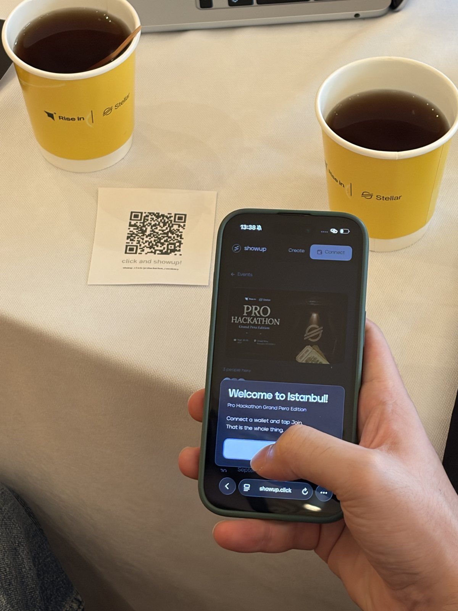

# Customer development — where Showup met its users

Two records: a room of seventy to eighty people at a hackathon, and one person taken
through the whole flow on their own screen with their own wallet.

---

## Pro Hackathon, Grand Pera Edition

**Rise In × Stellar — Grand Pera, Beyoğlu, Istanbul, 19–20 September 2026.**

Showup was shown in person across both days to **70 to 80 people**, with a
page built and deployed for the room —
**[showup.click/prohackathon_residency](https://showup.click/prohackathon_residency)**,
open for the two days the hackathon ran — and printed QR cards left on the tables so
anyone could open it on their own phone.

### What came out of it

- **Members of the Stellar team saw it and gave feedback on where to take it next.**
- **An organiser said they would consider running their own event on it** — the first
  read from outside the project on the question that matters most: whether somebody
  who is not the builder would use it for their own crowd.
- **Another team proposed building on top of it**, integrating Showup into the project
  they were working on at the hackathon. Interest in it as a *layer* rather than a
  destination is the clearest sign that the registration problem is felt by builders
  as well as by organisers.
- **Several people asked how the system was designed** — the gates, where the deposit
  is held, what the contract decides and what the screen only displays.

### What it confirmed

**Most of the people shown Showup already held a Stellar wallet.**

That is the assumption the whole go-to-market rests on, and this is the first direct
evidence for it. Starting inside the Stellar ecosystem rather than with restaurants or
five-a-side football groups was a deliberate choice: everywhere else a deposit begins
with a wallet problem, and here it begins with a scheduling problem — which is the one
Showup is for.

### The page built for the room

The roll call deliberately touches no contract and holds no deposit. Its only job is
to get a room full of people past "connect a wallet" in a single tap, at an event
where asking each person to fund a Testnet account and sign a transaction would lose
most of them at the door.

Because of that, nothing it records is ever presented as attendance evidence.
Attendance evidence comes from the chain — twenty-four reservations and twenty-one
check-ins this period, each one a signed transaction openable by anyone. That
separation is the argument the rest of this repository makes, and the roll call is
built to respect it.

---

## A recorded session, with the whole flow on one person's screen

Someone taken through Showup end to end on their own machine, with their own wallet:
opening an invite link, connecting, landing on the wrong network and fixing it,
funding an empty Testnet account, locking a 10 XLM deposit to take a spot, checking in
to get it back, and opening the transaction on a public explorer.

### What they asked for

The feedback was not about the mechanic — the deposit, the refund and the settlement
were not what they wanted changed. **It was about the organiser being a person.**

> *As a creator, being able to write more detail about my event. Adding my Twitter
> link. Being able to show more of myself here. That would be nicer. Apart from that
> everything looks good.*

Three requests, and they are one request: **an organiser wants to be legible.**

- **More room to describe an event.** Today a Showup event carries a title, a time, a
  deposit and an admission rule — everything the contract needs and nothing the
  organiser would say about it. The contract's fields are the ones that must be true;
  they are not the ones that make somebody want to come.
- **A link out to who they are.** An X account is how most organisers are already
  known, and a wallet address is not.
- **A presence rather than a row.** They did not ask for a bigger profile page; they
  asked to be more than an address on an event they created.

### Why it lands where it does

This is the organiser asking for the half of trust the chain cannot supply. Showup
proves attendance — that is settled, and it is why `/u/<address>` exists and reads
live from the ledger. What it has never carried is **who the organiser is**, and a
guest deciding whether to lock a deposit with a stranger is making exactly that
judgement.

It arrived independently of the roadmap and pointed at something already on it:
profiles with an X link, claimed by the same wallet signature that protects display
names today. The one piece it added was event description — the organiser's own words
about their own event, which nothing in the product currently has a place for.
