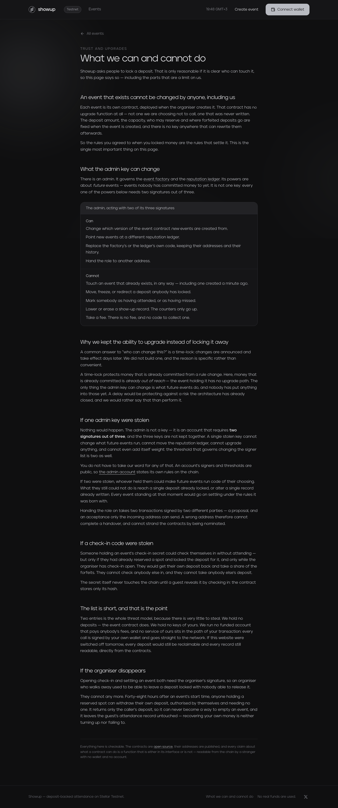

# Deliverable 2 — evidence

**Audit readiness, and keys no one person holds.** Before these contracts went
anywhere near real money they were frozen at one commit, put through the static
analysis an audit expects to have been run first, and handed to an account that
cannot be moved by any single key.

> **SOW §6.1:** the CI run showing `soroban-scanner` and Scout over all three
> contracts; the report, with every finding, its fix, and the reasoning for
> anything left unfixed; the transaction that rotated the admin key to hardware;
> and the upgrade-policy and trust-assumptions page on the live site.

**Two lines of that are not met as written, and are answered at the bottom of
this page** rather than paraphrased away: `soroban-scanner` is attempted but not
in CI, and the key went to a 2-of-3 account rather than to a hardware device.

---

## The report

**[security.md](security.md)** is the deliverable. In summary:

| | |
| :-- | :-- |
| Analyser | **CoinFabrik Scout `0.3.17`**, pinned, 39 detectors |
| Scope | all four crates — `event`, `factory`, `reputation`, `interfaces` |
| Findings | **73** |
| Fixed | **12, including every critical one** |
| Remaining | 61, each with a written decision |

The eleven criticals were all `integer_overflow_or_underflow`, and they were real:
the arithmetic they pointed at is now bounded at creation and checked at every
step. See [deliverable-1.md](deliverable-1.md) for what that changed.

**A report with no findings is a report nobody believes.** The 61 that remain are
not oversights — each has a reason written next to it, and most are the analyser
correctly describing a deliberate choice.

Pinned on purpose: a detector set that changes underneath a report makes every
finding in it unreproducible.

---

## It runs on every change, and it blocks

The `Security` job runs on every push that touches the contract layer. It spent
its first days as non-blocking while the findings were being triaged — **a job
that is red on 73 known findings is a job everybody learns to ignore** — and has
been blocking since 21.11.2026.

### The gate is a baseline, not a count of zero

[`scripts/check-scout-baseline.mjs`](../../scripts/check-scout-baseline.mjs) fails
the build on:

- any critical finding,
- any detector reporting **more** than the number recorded against it, and
- **an empty report.**

That last one matters more than it looks. Zero findings does not mean the code got
clean; in practice it means the analysis never ran. A gate that cannot tell
success from "did not execute" is not a gate — and this one has fired for exactly
that reason, correctly, when a cached toolchain broke underneath CI.

### The scope rule is the whole push

A push of two commits where only the earlier one touches the contracts is exactly
the case a `HEAD~1..HEAD` comparison gets wrong — and it did get it wrong here,
letting the fix to this very job reach `main` unanalysed alongside a web-only
commit. The range is now the whole push.

---

## The admin: an account no single key can move

Both contracts on both networks are governed by accounts requiring **two
signatures out of three**, with the three keys kept in three places.

| Network | Admin account |
| :-- | :-- |
| Testnet | [`GBWMYPV6…LEAF5QQF`](https://stellar.expert/explorer/testnet/account/GBWMYPV6274EVO3MVQMEQWGRSEFGE7ZSEJSNWYGMBV4WF7OQLEAF5QQF) |
| Mainnet | [`GCHKQ5BI…RPYV2NOG`](https://stellar.expert/explorer/public/account/GCHKQ5BIFT55QZMZFW5OMXN2MNWQP3GUFJWNHYV2PUEPOYI6RPYV2NOG) |

**You do not have to take our word for it.** An account's signers and thresholds
are public ledger state — open either link and read them.

### Mainnet, 27.11.2026

| Step | Transaction |
| :-- | :-- |
| B and C added as signers, threshold still 1 | [`ed7b4a50…`](https://stellar.expert/explorer/public/tx/ed7b4a502099c0906ffc695acef10610331914fcd1bc74873d1f51f45c2d41c7) |
| **B governs alone** — a real admin call, B's signature only | [`8e9eb60f…`](https://stellar.expert/explorer/public/tx/8e9eb60fd6eaba88d249904e14fd113681ea1ecad91f5a47869b7e9cf6158816) |
| **C governs alone** — the same | [`76fbe93e…`](https://stellar.expert/explorer/public/tx/76fbe93e8e7cac7136abbf732625589a21a750a15afa56848685c9ed9e7ead0e) |
| Threshold raised to 2 | [`0b5b30cf…`](https://stellar.expert/explorer/public/tx/0b5b30cf711dbf3e5c994156fccf95cb7b259cfd0c43b2d60fd6300b6cc0d24a) |
| **Two signatures accepted** | [`ac5cd05a…`](https://stellar.expert/explorer/public/tx/ac5cd05abf0a689649eac15bb281db998bef0971dafb0be28bc048bccf998f39) |

On Testnet the role also had to *move*, which took a two-step
`propose_admin` / `accept_admin` on each contract — four more transactions,
recorded in [deployments.md](../deployments.md).

### The order is the safety, and it is the part worth reading

Raising a threshold to 2 is **irreversible by one key**: lowering it again needs
the threshold met. An account whose other holders cannot really sign is therefore
not inconvenienced, it is finished — no upgrade, no `set_event_wasm_hash`, no way
back. *"The holder says they have the key"* is not evidence of this.

So the irreversible step came last, and before it each holder **signed and
submitted a real admin call alone**, while one signature was still enough. Not
"this signature verifies" but "this key governs". The call each made was
`set_event_wasm_hash` with the hash the factory already had — a genuine admin
call that changes nothing.

### The refusal is the security property

The same envelope that succeeded above was first submitted carrying only the
build machine's signature. The network refused it **`txBadAuth`**.

One of the three keys is on the machine this project is built from. It cannot act
alone — and with the **high** threshold also at 2, it cannot change the signer
list to give itself more weight either, which would be the same key holding the
whole account by a slower route.

---

## The tools, and why the admin needs three commands

The `stellar` CLI signs with exactly one key, which is fine for one keypair and
impossible for a multisig account. So admin calls go through
[`web/scripts/admin-tx.mjs`](../../web/scripts/admin-tx.mjs) as **build · sign ·
send** — one machine prepares, each holder signs what it was handed, whoever has
the complete envelope submits. The transaction travels as base64, so **no secret
ever has to be in the same place as another secret.**

[`web/scripts/admin-account.mjs`](../../web/scripts/admin-account.mjs) keeps
adding signers and raising the threshold as two separate commands, for the reason
above: a single command doing both would make the dangerous order the easy one.

---

## `/trust` — the same facts, in the product

**[showup.click/trust](https://showup.click/trust)** says, to the people whose
money it is rather than to a reviewer reading a repository: what can be upgraded,
what cannot, who holds the keys, and what an attacker holding one of them — or
two — would actually get.

It includes the parts that are a limit on us. The event contract has **no
`upgrade` at all**, so the rules a deposit was placed under cannot be rewritten
afterwards by anybody, ourselves included. Every address on that page is the one
governing the network you are reading it on, and every link goes to the chain.

---

## Where this does not match §6.1 as written

**`soroban-scanner` is not in CI.** The SOW names two analysers and CI runs
one. It was attempted — see [the write-up](security.md#the-second-tool-and-why-it-is-not-in-ci):
at its latest commit it panics before analysing anything, a second panic follows
in a detector that assumes ordinary Soroban code has a different shape, and with
both worked around it reports nothing **on its own positive fixture**. A tool
that does not fire on the case it ships to demonstrate itself cannot be cited as
a second opinion. Scout remains the analyser of record.

**The admin went to a 2-of-3 account, not to hardware.** §6.1 says "the
transaction that rotated the admin key to hardware"; there is no hardware device
and the role went to an account requiring two signatures out of three, held in
three places.

On the substance this is the stronger of the two: a hardware wallet is one key in
one place, and losing or compromising it is a single event. Three keys with a
threshold of two survive losing any one of them and resist stealing any one of
them. But it is **not what the sentence says**, and a reviewer comparing the
document to the work should find that difference stated here rather than discover
it themselves. It is an open item with the Chapter Lead.
