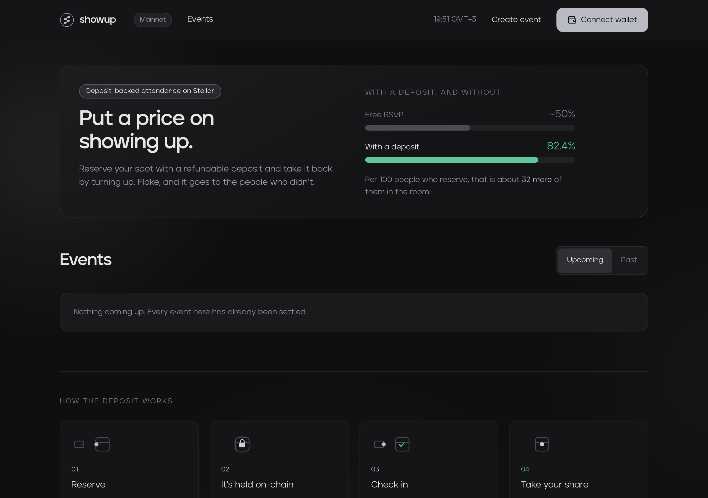
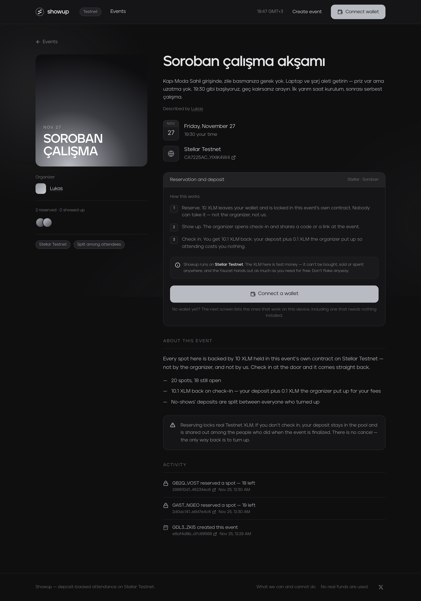
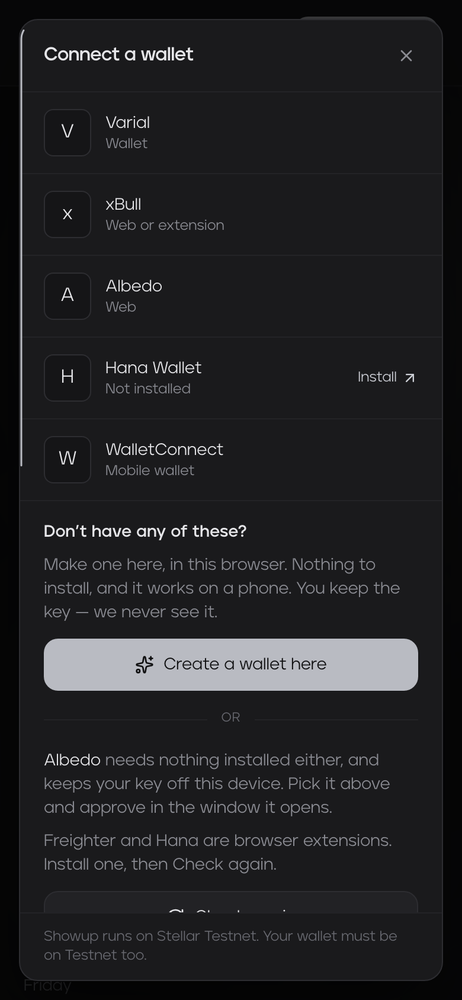
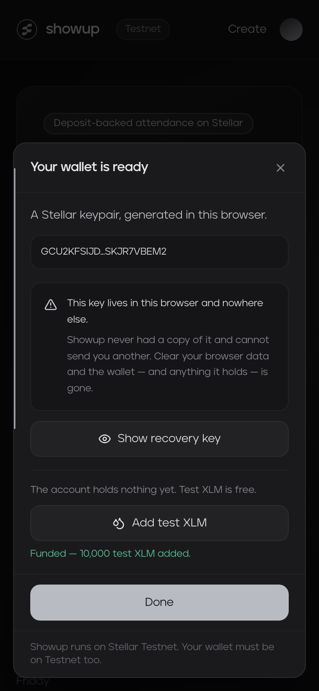

# Deliverable 3 — evidence

**Mainnet, and the product around real money.** Showup has been on Stellar
Mainnet since 27.11.2026. The deposits there are real XLM, and the whole point of
this engagement is that losing one would actually cost somebody something.

> **SOW §6.1:** Mainnet addresses for all three contracts, re-checked by CI from
> the chain; the complete transaction record of one real event, ending in a
> deposit back in a real wallet; screenshots; and the demo video.

---

## The contracts

| What | Address |
| :-- | :-- |
| **Event factory** | [`CCJLDI57GNYKSMP75QTPLUYGJV6VXN2LBT2SEYWVDRLJSBMWWS6E5ZVJ`](https://stellar.expert/explorer/public/contract/CCJLDI57GNYKSMP75QTPLUYGJV6VXN2LBT2SEYWVDRLJSBMWWS6E5ZVJ) |
| **Reputation ledger** | [`CBFOLND667UO3XLHCSBYHGZ4KE45F5BBFTX425I3PPTBVUJJ2SISWS6M`](https://stellar.expert/explorer/public/contract/CBFOLND667UO3XLHCSBYHGZ4KE45F5BBFTX425I3PPTBVUJJ2SISWS6M) |
| **Event wasm hash** | `5f5e0ec548c2142f6c64427c666ecef71bfa31589f43cd3e02d82659db7d5d03` |

**That hash is the Testnet hash.** The same three binaries, byte for byte — what
has been analysed, audited and run through two engagements is what now holds real
money. Nothing was rebuilt for Mainnet and nothing needed to be.

CI asks **each network's own factory** what it actually deploys, on every push.
Both tables verify themselves; a mismatch on either fails the build.

Every transaction of the deployment — ten of them, plus what each cost — is in
[deployments.md](../deployments.md#mainnet--the-deployment-and-what-it-actually-cost-27112026).

### The path works on Mainnet, not just on Testnet

Before handing the keys over, one event was created from our own wallet and
finalized immediately:

| Step | Transaction |
| :-- | :-- |
| `create_event` | [`8eede647…`](https://stellar.expert/explorer/public/tx/8eede6472aaa0d43ae35f89e9eac895fe87c4b4e58e09ef7447432ee713368e7) |
| `finalize` | [`fca49e8a…`](https://stellar.expert/explorer/public/tx/fca49e8a32975ab9e9ca78af38e9b8a484477bc56e1414f375ed73399d74ea90) |

The event settled to `Finalized` and the reputation ledger recorded
`events_organised: 1` for the organizer **in the same transaction**. So the
factory gate, the settlement and the atomic reputation write are all proven on
Mainnet rather than assumed from Testnet.

It was also run for a practical reason that turned out not to apply. On Testnet,
the first event created from a freshly uploaded wasm costs 36–106 XLM against a
median of about 0.5 — a bill that on Mainnet would land on a real organiser for
nothing they did. It cost **0.22 XLM** here, because Mainnet charges the code
entry's rent at *upload* time instead. There was no way to know that in advance,
and the alternative was letting the first organiser find out.

---

## Two networks, one build

| | `showup.click` | `testnet.showup.click` |
| :-- | :-- | :-- |
| Network | **Mainnet** | Testnet |
| The deposit | **Real XLM** | Free, and worth nothing anywhere |
| Faucet | None, and the UI never offers one | Friendbot |
| Before you reserve | A confirmation step naming the amount | One tap |

**Mainnet is an allowlist of exactly one hostname.** Everything else — the
Testnet subdomain, a preview deployment, localhost, a hostname somebody typed
wrong — resolves to Testnet. The asymmetry is the design: the worst outcome of a
misconfiguration becomes *"this showed Testnet when it should have shown
Mainnet"*, which is visible and harmless, instead of *"this looked like Testnet
and moved real money"*, which is neither.

A network also is not *live* until it has both contracts **and** somewhere to ask
about them, so a deployment missing its Mainnet RPC serves Testnet rather than
offering a network whose every read would fail.

---

## The real-money confirmation

On Testnet a full-width button is the right control: the deposit is faucet XLM
and the only cost of a misclick is a second one to undo it. On Mainnet the same
gesture moves somebody's money, so it buys a step that **names the amount instead
of performing it** — before the wallet asks for a signature, at which point the
question has already been reframed in the wallet's words as a transaction rather
than as a deposit.

The two are deliberately asymmetric. A confirmation on both would train people to
click through the one that matters.

The same rule governs the copy. The sentence *"it isn't real money"* and the
sentence *"this is real XLM"* are written as two separate blocks rather than one
template with the network interpolated — a template that can produce the
reassuring version on Mainnet by getting a flag wrong eventually will. Tests
assert the **absence** of the words "faucet", "test network" and "worth nothing
anywhere" on Mainnet, because the dangerous failure is not a missing warning but
a reassurance that survived.

---

## An event in its organizer's own words

A contract knows a deposit, a capacity and a start time. It does not know where
the door is or what to bring. Hosts can now write that down — stored off-chain,
but with **who may write it read from the chain**: the route loads the event and
checks the wallet against the contract's own `hosts` list before accepting a
word, and does so *before* spending the signature, so an RPC failure costs a
retry rather than another trip to the wallet.

---

## A wallet for somebody who has never held one

This deliverable turns on strangers finishing a reservation unattended, on their
own phone. Showup offers five wallets and three of them want an install first, so
on Testnet there is now a sixth option that asks for nothing: **a Stellar keypair
generated in the browser**, one tap, no extension, no app, no pop-up.

It is a real wallet from the chain's point of view. One created this way deployed
its own event contract and signed a reservation into another:

| What | On Testnet |
| :-- | :-- |
| Event contract deployed by an in-app wallet | [`CDNPAUKG…KGKRY`](https://stellar.expert/explorer/testnet/contract/CDNPAUKG6PBAPX5VOLPJRI3ZBICOHROTR4EJ3EFGILILZAMRLCOKGKRY) |
| The wallet that deployed it | [`GB5TXR6J…JHBFMQ`](https://stellar.expert/explorer/testnet/account/GB5TXR6JGXNIPKMQG7CASOM7HGQPVG5AD6TCQK5P3UIVENFE52JHBFMQ) |
| A deposit reserved by an in-app wallet | [`5256d6a4…`](https://stellar.expert/explorer/testnet/tx/5256d6a4c5b056ae25737f8fe45d0adc288c09cd2435ac8d0b42217457e92973) |

The contract above carries the same event wasm hash as every other event,
`5f5e0ec5…`. Nothing about the signer is special to the chain — which is the
claim worth making, because it means this path produces the same evidence as any
other.

| Offered to anyone with nothing installed | The key, the moment it exists |
| :--: | :--: |
|  |  |

Both on a 390px phone, which is the device this exists for. The screenshots in
these pages are taken by
[`scripts/capture-screens.mjs`](../../scripts/capture-screens.mjs), and the
connected ones are now taken the same way — the script makes a wallet in the page
exactly as a visitor does, so a reviewer is looking at the real flow.

### It exists on Testnet, and the reason is the honest one

The key is kept in `localStorage`, which is readable by any script that reaches
the page. That is a fair trade for money that is free and worth nothing anywhere,
and it is the wrong trade for money that is not: **an in-app key holding real
funds is custody**, a different product with obligations this one has not taken
on.

So the restriction lives in the library rather than in a screen. `create`, `load`
and `signWith` each check the network themselves, which means a component wired
up by mistake still produces nothing on Mainnet. `signWith` repeats a check the
other two already make, deliberately — it is the function that would move money
if either of them were ever wrong, so it does not trust them to have been right.

Each of those guards is covered by a test that was **confirmed to fail when the
guard is removed**, one guard at a time. A test that passes whether or not the
protection is there would be the more dangerous thing to ship.

### Export is the feature

A key the app holds and the person does not is the app's key. The screen that
appears the moment a wallet is created shows the address, offers the secret to
copy or save as a file, and says in the same breath that Showup never had a copy
of it. The wallet menu keeps that panel, with the key hidden until it is asked
for — the menu gets opened in front of other people.

Deleting an in-app wallet and disconnecting a wallet app are kept as two separate
controls, because they are two different events: one is reversible and the other
destroys the only copy of a key and whatever it holds. The delete step names the
balance it is about to take with it.

---

## A wallet that can say who it is

A record page identifies a wallet by 56 characters. Wallets can now attach an **X
handle and an Ethereum address** to that record, each edit authorised by a Stellar
signature from the wallet itself.

It renders under the words *"This wallet says"*, with no tick, no badge and no
colour. The signature proves somebody holds *this Stellar wallet*; it says
nothing about the X account or the Ethereum address they typed, and the single
way this feature could mislead is by implying otherwise inside our own chrome.

Handles are checked for the characters that let one name render as another — a
right-to-left override, a zero-width space, a Cyrillic `а` beside a Latin `a` —
because the value becomes an `href` next to an attendance record. Ethereum
addresses keep the case exactly as typed: mixed case there is EIP-55 checksum
information, and this is a field people paste by hand, which is precisely when a
checksum earns its place.

---

## Not finished

§6.1 asks this deliverable for more than is on the page above. Listed in full
rather than quietly omitted, because a page that reports only its completed items
is not evidence of anything.

**Waiting on an event that has not happened** — scheduled 02–04.12.2026:

- [ ] A real Mainnet event with real attendees, run to settlement, every
      transaction hash recorded.
- [ ] A real deposit arriving back in a real wallet.
- [ ] The demo video.
- [ ] The real-money confirmation screenshot, which only renders with a wallet
      connected to a live Mainnet event.

**Scheduled for a later engagement:**

- [ ] **An organiser's announcement arriving as an email.** First on the written
      list of what falls if the month runs short: nothing depends on it, and the
      per-event conversation already reaches anybody holding a spot.
- [ ] **A vouch that stakes the voucher's own XLM.** Third on that list. The
      vouch itself is live and enforced on-chain — a broken one closes vouching
      for that wallet permanently — so what is deferred is the deposit behind it,
      not the mechanism.

The written fall order, decided at the start of the engagement rather than at the
end of it, was: organiser emails, then email entirely, then staked vouches, then
descriptions and profiles. The list was worked from the bottom up: **descriptions
and profiles — the last item, and the one most likely to fall — were both
built**, and the in-app wallet was added on top of them.

The tooling is ready for it:
[`web/scripts/collect-evidence.mjs`](../../web/scripts/collect-evidence.mjs) reads
every `reserved`, `checked_in`, `phase_changed` and `finalized` event straight off
the chain and prints the evidence table as markdown, on either network. **None of
the tables in these pages were typed by hand**, and the script disagrees with them
if anyone edits a hash.
